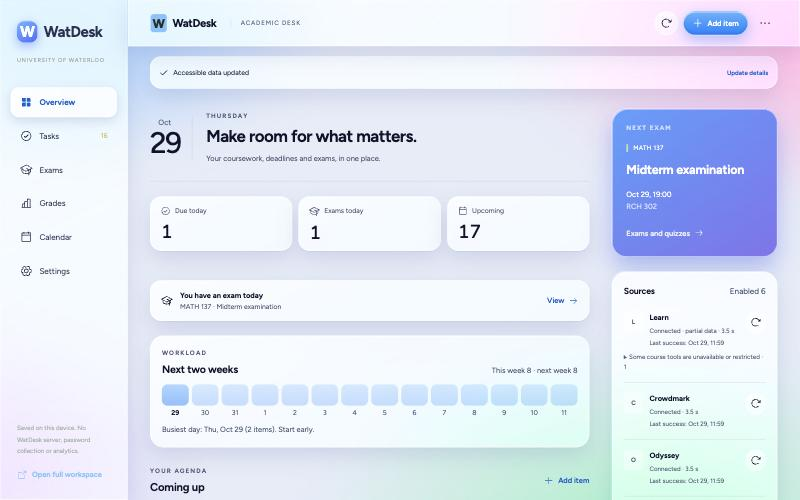
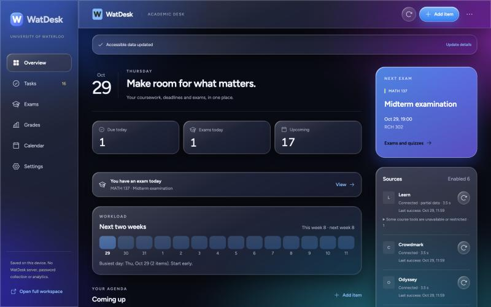
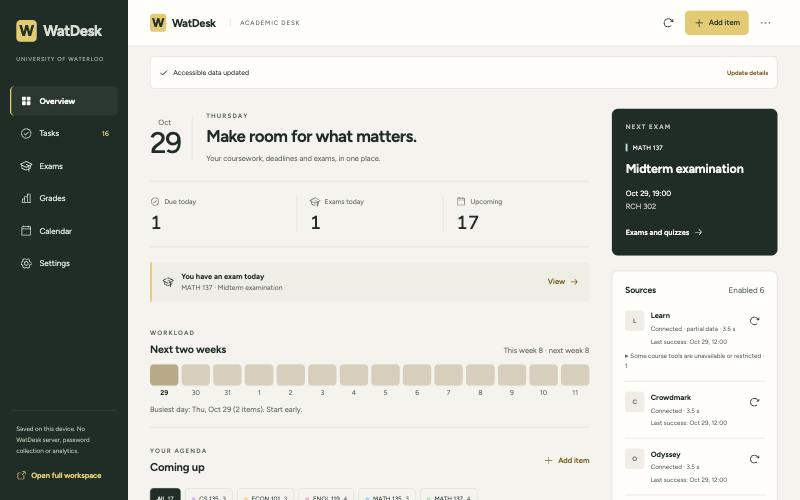

# WatDesk

**滑铁卢课程的一张安静书桌。** 把 LEARN、Crowdmark、Odyssey 的作业、考试和成绩放进 Edge 侧边栏，一眼看清下一件要做的事。

[**下载最新版**](https://github.com/Jelly-RayTian/WatDesk/releases/latest) · Edge 商店：审核中 · [问题反馈](https://github.com/Jelly-RayTian/WatDesk/issues/new/choose) · [English](README.md)

> 这是学生独立开发的项目，不是滑铁卢大学官方产品。

## 你能得到什么

- **统一时间线**：LEARN、Crowdmark、Odyssey 的作业、测验和考试按天排列，可按课程筛选。
- **未来两周工作量**：提前看出哪几天会很满。
- **考试页**：倒计时、教室和座位、变更提醒，以及课程筛选。
- **成绩**：可排序、可估算，已公布的成绩和估算分开显示。
- **日历、提醒和 `.ics` 导出**：截止日期可以放进你常用的日历。
- **安静同步**：后台读取，不抢你的标签页；网站暂时打不开时保留旧数据。
- **简体中文和 English**、浅色和深色，以及包括**液态玻璃**在内的五种风格。

## 安装（约 3 分钟）

1. 到 [Releases](https://github.com/Jelly-RayTian/WatDesk/releases/latest) 下载 ZIP 并解压。
2. 打开 `edge://extensions`，打开**开发人员模式**，点**加载解压缩的扩展**，选择直接包含 `manifest.json` 的文件夹。
3. 固定 WatDesk，点图标打开侧边栏，用你自己的账号连接 LEARN、Crowdmark 和 Odyssey。密码和验证码都在原网站输入。可以先连一个，其余以后再加。

**更新：** 先在 *设置 → 我的本地数据* 导出备份，用新文件覆盖原文件夹，再在扩展卡片上点**重新加载**。不要移除扩展，否则本地数据会被删除。

## 能读取的课程

| 来源 | WatDesk 读取的内容 |
|---|---|
| LEARN、Crowdmark、Odyssey | 截止时间、测验、已公布成绩、提交状态、考试时间、教室和座位 |
| CS 135（可选） | 课程日历、作业、测验和提交记录 |
| CS 145、CS 240、CS 241（可选） | 课程网站上的作业截止时间和考试时间 |
| 另外 22 个 CS 课程网站（可选） | 仅链接，显示在“课程资源”里 |

可选课程默认关闭，因为不是每个人都有。在 *设置 → 数据来源 → 添加可选来源* 里打开。从课程网站读到的日期会带“请与原页面核对”的提示，因为这些网页是手写的，可能会改版。

## 你的数据属于你

- 学业数据都保存在你自己的浏览器里，不上传到 WatDesk 后台，也不需要另建账号。
- WatDesk 不会看到或保存你的密码、Cookie 和验证码，也不会替你提交任何东西。
- 没有广告。提供匿名“有多少人在用”计数；**默认开启，可在首次使用界面或设置中关闭**，设置页会显示它到底发送什么。

详见[隐私政策](PRIVACY.md)。

## 常见问题

**必须连接全部三个网站吗？** 不用，连一个就能开始。

**为什么有时会打开一个标签页？** 有些页面必须渲染后才能读取，WatDesk 会用一个不激活的临时标签页，读完就关闭。

**日期看起来不对。** 请以原页面为准。LEARN、Crowdmark、Odyssey 公布的内容可能变化；WatDesk 会保留上一次可靠的数据，并在读取失败时提示你。

**手机能用吗？** 这是 Edge 桌面版扩展。

**出问题了。** [提交 issue](https://github.com/Jelly-RayTian/WatDesk/issues/new/choose)，请不要贴密码、验证码或私人成绩。

## 更多风格

## 开发者

构建、测试和发布说明见 [docs/DEVELOPING.md](docs/DEVELOPING.md)，每个行为的详细说明见 [docs/GUIDE.md](docs/GUIDE.md)。可选使用计数的服务端在 [stats-worker/](stats-worker/README.md)。

WatDesk 复用了 [WATnow](src/vendor/watnow/LICENSE) 的两个 MIT 许可读取模块，见 [THIRD_PARTY_NOTICES.md](THIRD_PARTY_NOTICES.md)。
